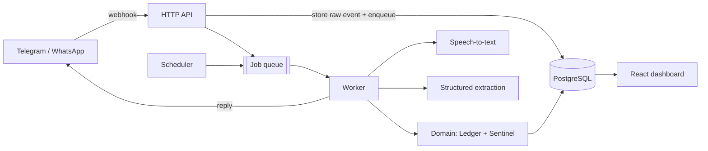

# AUREUS · Zero-Friction Household Finance Assistant

> 🇪🇸 Spanish version: [README.es.md](./README.es.md)

AUREUS is a backend that lets a family track expenses and never miss a bill, **without opening an app**. Users send a text, a voice note, or (later) a photo of a receipt through a chat app. AUREUS extracts the data, stores it in a consistent ledger, and sends reminders before due dates.

> **Status: in transition.** AUREUS started as a classic fintech dashboard. It is now being rebuilt around a chat-first workflow. The previous version is preserved in the [`legacy-aureus`](../../tree/legacy-aureus) branch. This README describes the **target design**; see the roadmap for what is already built.

---

## The Problem

Most personal finance apps fail for one reason: they ask users to change their habits. Nobody logs every coffee in a form. But people do two things every day: send chat messages, and forget to pay a bill on time.

AUREUS removes the friction:

1. **Assistant** – log an expense by chatting: *"1,200 for gas and 300 for dinner"*.
2. **Sentinel** – track due dates and send staged reminders to avoid late fees and service cuts.

## Core Features (MVP)

- Expense capture from **text** and **voice notes** (Telegram first, WhatsApp later).
- **Append-only ledger** with idempotent ingestion (webhook retries never create duplicates).
- Structured extraction with schema validation and a confidence score.
- User corrections stored as training data for a future classifier.
- **Bill Sentinel**: due dates, staged reminders, and a state machine (`pending → reminded → paid | overdue`).
- Weekly three-line summary.
- Optional React dashboard for reports and corrections.

## Architecture

A **modular monolith** using **hexagonal architecture (ports and adapters)**, plus a separate background worker.



The webhook only validates the request, stores the raw event, and answers `200` quickly. Heavy work happens in the worker.

### Target folder structure

```
src/
├── domain/            # Entities, business rules, state machines (no dependencies)
├── application/       # Use cases: RecordExpense, ScheduleReminder, WeeklySummary
├── infrastructure/
│   ├── messaging/     # TelegramProvider implements MessageProvider
│   ├── ai/            # Transcriber, ExpenseExtractor adapters
│   ├── persistence/   # PostgreSQL repositories
│   └── queue/         # pg-boss job queue
└── interfaces/http/   # Webhook and dashboard API
```

### Design patterns

| Pattern | Why it is used |
|---|---|
| Ports and Adapters | Swap Telegram for WhatsApp, or one LLM for another, without touching the domain. |
| Idempotency key / Inbox | A `UNIQUE` constraint on the message ID makes webhook retries safe. |
| Transactional Outbox | State changes and outgoing messages are saved atomically. |
| State Machine | Explicit, valid transitions for bills. |
| Append-only Ledger | Full audit trail; corrections are new entries, never edits. |
| Schema-validated pipeline | `audio → text → LLM → JSON → Zod → confidence check`. |

### Key decisions

- **Modular monolith**, not microservices: one developer, one deployment.
- **PostgreSQL on Supabase**, used as plain managed Postgres with SQL migrations to avoid vendor lock-in.
- **`pg-boss`** for queues on the same database (no Redis to operate).
- Money stored as **integers (minor units)**, never floating point.
- Dates stored in **UTC**, displayed in `America/Santo_Domingo`.
- **Telegram first**, behind a `MessageProvider` interface, to avoid the ban risk of unofficial WhatsApp libraries.

## Tech Stack

TypeScript · Node.js · Express · Zod · PostgreSQL (Supabase) · pg-boss · Vitest · Supertest · GitHub Actions · Docker

## Roadmap

- [x] Express + TypeScript base, Zod validation, CI, Dockerfile
- [x] PostgreSQL migrations with RLS and audit trail
- [ ] Hexagonal restructure of `src/`
- [ ] Telegram webhook with idempotent ingestion
- [ ] Job queue and text expense extraction
- [ ] Voice note transcription
- [ ] Bill Sentinel and reminders
- [ ] Weekly summary
- [ ] Receipt photos (OCR, Dominican NCF/ITBIS support)
- [ ] Pilot with 3–4 real family members

## Privacy and Cost Controls

- Never store card or bank account numbers.
- Delete receipt images after processing.
- Daily limit on AI calls per user.

## Branch Strategy

| Branch | Purpose |
|---|---|
| `develop` | Active development |
| `qa` | Quality assurance and regression |
| `main` | Stable, production-ready |
| `legacy-aureus` | Frozen snapshot of the original fintech version |

## Getting Started

Requirements: Node.js 20+ and npm 10+.

```bash
npm install
cp .env.example .env
npm run dev        # http://localhost:3001
npm test           # run the test suite
npm run build && npm start
```
